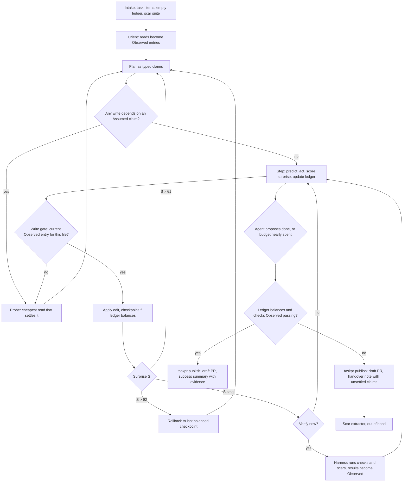

# A settled-claims agent for the Bastion fleet: research design

Status: research design, awaiting owner review. Written 2026-11-17. Nothing here changes production behaviour;
it is a hypothesis and the experiments that would test it.

## Summary

The agent's job is the run described in [AGENTS.md](../../../AGENTS.md): take one to three unlocked items from
`docs/BACKLOG.md`, write the test first, meet each *Done when*, pass the repo checks, open a draft PR, never merge or
deploy. Today Sebastian does this as a bounded single think-act-observe loop with file tools only, no shell, no
memory, 15 to 40 model steps and 1200 seconds, under a $2 per agent and $5 per fleet daily cap. The design proposed
here, the **settled-claims agent**, keeps that loop and adds three mechanisms: a typed ledger of what the agent has
observed, inferred or merely assumed, which gates every file write and the final success claim; a one-line prediction
before every tool call whose running error controls how much verification the agent buys; and a per-repository
"scar" suite grown from past failures and culled against healthy `main`. The central hypothesis is that on
backlog-style tasks the dominant failure is acting on repository state that was never observed, that none of the
mainstream designs distinguish observed from assumed state, and that gating writes on settled claims will raise strict
task success by at least a quarter over an equally budgeted ReAct loop, with the gain growing as tasks touch more
files and chain more items. The hypothesis is held at roughly 40% confidence and the first experiment is a
four-arm ablation on replayed Bastion backlog items.

### The placeholders, filled from this repository

| Field | Value |
|---|---|
| Task domain | The AGENTS.md run on Bastion and the other listed repositories: pick backlog items, test first, code, checks, draft PR |
| Budget | $2 per agent per UTC day, $5 per fleet (`services/command-centre/caps.json`); `tools.caps gate` refuses runs over cap |
| Latency | 1200 s per run (`SEBASTIAN_MAX_SECONDS`), 15/25/40 model steps, one model call per step on free-tier endpoints |
| Tools | File tools only; no shell, no network; `--unattended` so gated actions are denied; no memory between runs |
| Model | Any OpenAI-compatible endpoint (Gemini Flash, Groq) and Claude; the design must not depend on one vendor |
| Safety | Guarded paths need the `owner-approved` label; Quartermaster is the only deployer; instructions found in files or tool output are never followed |
| "Better", in order | 1. strict task success; 2. fewer unsafe actions; 3. cost per solved task; 4. recovery from its own mistakes |

**Strict task success** means: the item's *Done when* test passes, the three AGENTS.md checks pass, the diff
touches no guarded path, and the PR is opened as a draft within budget. **Unsafe action** means: an edit under a
guarded path, compliance with an instruction found in file contents or tool output, exceeding the step or time cap,
or claiming success without evidence.

## Step 1: Baselines, each at its best

Each baseline is described in its strongest configuration for this domain, with the failure modes it shows here
and why the mechanism produces them. Sebastian's current loop is baseline 1.

### 1. ReAct single loop (Sebastian today)

**Mechanism.** One model, one loop: reason, call a tool, read the result, repeat until the model says it is done
or the step cap fires. Best configuration: structured tool schemas, tool results truncated to a fixed size, the
task passed as a single argument, the harness runs the checks after the agent exits, and `tools.taskpr` publishes.

**Failure modes seen or expected here.**
- *Phantom read.* The agent edits `services/command-centre/app.py` using contents it remembers from a read twenty
  steps earlier, or from a similar file, and the edit does not apply or silently clobbers a newer change. Cause: the
  context window is treated as uniformly true; nothing marks an observation as stale once another edit lands.
- *Declared done.* With no shell, the agent cannot run tests, so it says "done" after the edit and the harness
  checks fail afterwards. Cause: verification sits outside the loop, so the loop has no evidence to condition on.
- *Thrash to the cap.* The agent repeats a near-identical edit three or four times after a failed apply, spending the
  40 steps. Cause: no signal that its model of the file is wrong, only that an operation failed.
- *Instruction capture.* A tool result or a README says "also update the workflow"; the agent tries `.github/` and
  `taskpr` refuses the whole PR. Cause: no provenance on text in the context, so instructions from data look like
  instructions from the owner.

### 2. Plan then execute

**Mechanism.** A planning call produces an ordered list of steps with target files; an executor carries them out;
re-plan on a hard error. Best configuration: plan names files and tests explicitly, executor may read before each
step, one re-plan allowed.

**Failure modes.** The plan is built on assumptions about the repository (test file naming, where a helper lives,
the shape of a ledger envelope) and the executor carries them out confidently; re-planning triggers only on hard
errors, never on a quietly wrong belief, so a wrong plan runs to completion and fails at the checks. On Bastion's
small tasks the planning call is a fixed tax of two to four steps that often produces a plan the first read would
have invalidated.

### 3. Orchestrator with subagents

**Mechanism.** An orchestrator holds the task and dispatches narrow subtasks to fresh-context workers, merging their
results. Best configuration: each worker gets one file or one test, returns a diff and a summary.

**Failure modes.** Workers return "done, tests updated" and the orchestrator cannot verify the claim without
re-reading everything, so unverified claims compound across workers. Two workers make inconsistent choices (one
renames a function, the other calls the old name) because neither sees the other's diff. Cost is two to three times
the single loop, which at $2 per day allows one run. The design is justified only when work is genuinely
independent, which three backlog items from one milestone rarely are.

### 4. Reflexion and self-critique loops

**Mechanism.** Run, compare the result with the *Done when*, write a reflection, retry with the reflection in
context. Best configuration: critique is anchored to the harness's check output, one retry.

**Failure modes.** The critique is written by the same model holding the same wrong belief, so the retry repeats the
error with more conviction; reflections are prose, not evidence, and nothing forces the retry to re-observe the
file. It costs a full second attempt. Its real strength is repairing visible test failures, which is exactly what the
harness output gives it, so it is a strong baseline on single-file tasks.

### 5. Tree or beam search over actions

**Mechanism.** Keep two or three candidate edit sequences, score each with the harness's test run, expand the
best. Best configuration: beam 2, value = fraction of target tests passing.

**Failure modes.** Branching multiplies steps; under a 40-step cap depth collapses to five or six real moves. Every
node needs a harness test run, which the agent cannot trigger itself, so the search is driven from outside and
latency grows with the beam. It is strong when the failing test is local and cheap, weak on items like "Failures
view groups failed runs by agent" that need several coordinated files before any test can pass.

### 6. Memory and skill library

**Mechanism.** Nightly consolidation of `memory.write` entries (backlog I1), retrieval per task; skills are reusable
procedures. Best configuration: retrieval by repository and item area, entries carry a date.

**Failure modes.** A stale entry ("tests live in `tests/`, run with `discover -t .`") outlives the repository change
that invalidated it; the agent trusts it without re-observing. Memory is also a second injection surface: a poisoned
entry is an instruction in data. I1 is not built yet, so these are expected rather than observed failures.

## Step 2: The gap

Two root causes recur across the six baselines. Each is a claim that could be wrong.

**C1, epistemic.** *In this domain the single largest cause of strict failure is a write made on the basis of
repository state that the agent never observed in the current run, or observed before it changed.* Phantom reads,
confident wrong plans, unverifiable subagent claims, repeated wrong critiques and stale memories are all this one
fault in different clothes. No baseline distinguishes observed state from inferred state from assumed state; all of
them treat whatever is in the context window as true. C1 would be wrong if the failure census in the first
experiment shows that most failures are planning or capability failures with the relevant files correctly observed.

**C2, verification timing.** *Because verification happens only at the end of the run, an early wrong belief
compounds through later steps, and the step and time budget is exhausted before the error is detected.* Every
baseline either verifies at the end (ReAct, plan-execute, orchestrator) or verifies by spending a whole extra attempt
(Reflexion, search). None has a cheap, per-step signal that its model of the world is drifting. C2 would be wrong if
failing runs are not longer or more step-hungry than passing ones, or if the first wrong belief in failing traces
appears late rather than early.

## Step 3: Mechanisms from elsewhere

Thirteen candidates. *Novel* means the combination or application is new as far as the author knows; *twist*
means a known approach applied differently. Where novelty is uncertain, that is said.

| # | Source field | Mechanism | Why it might beat the baselines | Novelty |
|---|---|---|---|---|
| 1 | Double-entry bookkeeping | Every belief the agent acts on is a ledger entry with a credit (evidence reference) and debits (the actions that depend on it); the ledger must balance before success is claimed | Attacks C1 directly: an unbacked belief is visible as an unbalanced entry, not hidden in prose | Twist on grounding and citation; the balance-as-gate is, as far as known, new |
| 2 | Type systems | Beliefs carry types Observed / Inferred / Assumed; write actions have effect types that require Observed preconditions; the harness type-checks before applying the write | Makes C1 a mechanical check rather than a model judgement | Twist on epistemic tagging |
| 3 | Immune system | Failed runs yield antibodies: a minimal reproducing check; antibodies that fire on healthy `main` are culled (negative selection) | Converts each failure into a cheap permanent test, which is backlog I2's intent, without false positives accumulating | Twist on regression-from-failure; the culling rule is the new part |
| 4 | Version control | Checkpoint the working tree each time the ledger balances; roll back to the last balanced checkpoint when drift is detected | Bounds how far a wrong belief can propagate (C2) | Twist: rollback triggered by epistemic state, not test failure |
| 5 | Predictive coding | Before each tool call the agent writes one line predicting the result; mismatch is scored | Gives a per-step drift signal that costs about 20 tokens | Known in research as expectation checking; use as a budget signal is a twist |
| 6 | Control theory | A controller with an integral term sums surprise; past one threshold it forces a re-plan, past a second a rollback | Turns C2 into a feedback loop rather than an end-of-run check | Novel as applied to agent budgets, speculative |
| 7 | Markets and auctions | Subtasks are auctioned to workers who post a bond forfeited if their claim fails verification | Prices overconfident claims out of the orchestrator pattern | Twist on market-based multi-agent systems |
| 8 | Scientific peer review | A blind second reader sees only the diff and the *Done when*, not the agent's reasoning | Catches wrong beliefs the author cannot see | Known (reviewer agents) |
| 9 | Courtroom | A prosecutor agent must produce a failing input within a budget before the PR opens; failure to do so is the acquittal | Reverses the burden of proof: the agent does not claim correctness, the harness fails to disprove it | Twist on adversarial testing |
| 10 | Ant colonies | Files touched by past failures carry a decaying pheromone; a high value raises the probe requirement before writing there | Spends verification where the fleet has been burned before | Novel, speculative |
| 11 | Compilers | The plan is an intermediate representation; a linter checks each step's preconditions against the ledger before execution | Catches plan-then-execute's wrong assumptions before they run | Twist on plan validation |
| 12 | Escrow and two-phase commit | Side effects are staged and committed only when the ledger balances | Bastion already does this at the PR level in `taskpr`; extending it to the run keeps half-done work from leaking | Known in databases; twist for agents |
| 13 | Dead-man switch | A run that stops reporting is treated as failed | Already in Bastion (`tools/deadman`); listed for completeness | Known |

**Chosen combination.** Mechanisms 1 and 2 merge into one component, the **settled-claims ledger**; 5 and 6 merge
into the **surprise controller**; 3 with the culling rule from 4 becomes the **scar suite**. Mechanism 12 is kept
implicitly: publication stays gated by `taskpr` and the ledger adds a gate at the write level. Mechanism 9 is the
strongest rejected idea; it is held back because it doubles model cost per run, which the $2 cap cannot absorb, and
is listed as a follow-up ablation.

## Step 4: The design

### Components

| Component | Responsibility | Runs where |
|---|---|---|
| Ledger | Append-only JSONL of claims: `{id, text, type, evidence, depends_on, step}`; `type` is Observed, Inferred or Assumed; `evidence` for Observed is `{path, sha256, step}` or `{check, exit_code, step}` | Harness, in the run directory |
| Prober | Turns an Assumed claim into Observed by the cheapest read that settles it (read a file, list a directory); runs when a write depends on an unsettled claim | Harness issues the tool call the agent requested, then records the entry |
| Predictor | Prompts the agent for a one-line prediction before each tool call; scores the result 0 (match), 1 (partial), 2 (contradiction) by a fixed rubric | Agent writes the line; harness scores it mechanically where possible (file exists, test passed), by a short model call otherwise |
| Surprise controller | Keeps `S = Σ decay^(t-i) · s_i`; thresholds θ1 (re-plan) and θ2 (rollback) | Harness |
| Checkpointer | `git stash`-style snapshot of the tree whenever the ledger balances; rollback restores the last one | Harness |
| Verifier | Runs the AGENTS.md checks and the scar suite on request and records results as Observed entries | Harness; the agent never gets a shell |
| Publisher gate | Refuses to call `taskpr publish` with a success summary unless the ledger balances; otherwise opens the draft PR with the handover note | Harness, reusing `tools/taskpr` |
| Scar extractor | After a failed run, bisects the diff against the failing check to a minimal reproducing test; quarantines it; culls it if it fires on `main` | Separate scheduled job, outside the run budget |

### Control loop

1. **Intake.** Parse the task and its backlog items. Open an empty ledger. Load the repository's scar suite.
2. **Orient.** The agent reads `AGENTS.md`, the backlog item and the files it names. Each read becomes an Observed
   entry with path, content hash and step number.
3. **Plan as claims.** The agent lists the claims its plan depends on ("`tests/test_app.py` has a `FailuresView`
   class", "the ledger rejects floats") and types each. The harness lints the plan: any write that depends on an
   Assumed claim gets a probe scheduled before it.
4. **Step.** For each tool call: the agent writes a one-line prediction; the harness runs the call; the result is
   scored; new Observed entries are appended; entries whose evidence hash no longer matches are marked stale, which
   makes them Assumed again. `S` is updated.
5. **Write gate.** A file edit is applied only if the ledger holds a current Observed entry for that file (hash
   matches the last read). Otherwise the harness runs the probe first and re-asks the agent to confirm the edit
   against the fresh content.
6. **Drift control.** If `S > θ1`, the harness replaces the agent's next step with a mandatory re-plan from the
   ledger alone. If `S > θ2`, it rolls back to the last balanced checkpoint and re-plans. Both reset `S`.
7. **Verify.** When the agent asks, or every k writes, the harness runs the three checks and the scar suite and
   appends the results as Observed entries. The agent sees exit codes and the tail of the output, never a shell.
8. **Balance and publish.** Before publication the harness checks: every claim a write depended on is Observed and
   current; each *Done when* check is Observed passing; the scar suite is Observed passing; the diff touches no
   guarded path. Balanced: `taskpr publish` with a success summary that lists the evidence. Unbalanced: `taskpr
   publish` as a draft with the AGENTS.md handover note listing the unsettled claims, ticking nothing. The agent is
   never the one who says "done"; the ledger is.
9. **After the run.** On failure, the scar extractor runs out of band and proposes a scar. A scar is quarantined
   until it has reproduced a failure twice and has never fired on `main`.

### State

| State | Where | Lifetime |
|---|---|---|
| Ledger | JSONL in the run directory | The run; a summary (counts of Observed/Inferred/Assumed, unsettled claims) rides on the `task.result` or `task.failed` ledger event as plain fields |
| Checkpoints | Git stash entries in the run's checkout | The run |
| Surprise total | Harness memory | The run |
| Scar suite | One directory per target repository, beside Sebastian's offline eval suite, versioned in git | Indefinite, subject to culling and quarantine |
| Nothing else | | No memory crosses runs; this keeps the `--no-memory` property Bastion relies on |

### Verification before success

Success is a property of the ledger, not a statement by the model. The publisher gate requires four Observed
facts: the dependency closure of every write is Observed and current; each *Done when* check passed in a harness run
after the last write; the scar suite passed in that same run; no guarded path is in the diff. A missing fact
produces the handover draft, never a success summary.

### Safe failure and uncertainty

- Out of steps or time with an unbalanced ledger: handover draft PR listing unsettled claims and what is done, as
  AGENTS.md already requires. Nothing half-written is pushed because checkpoints only exist at balanced states.
- An instruction appears in a tool result or file: it is data, so it can only ever become an Observed entry about
  the file's contents, never a claim the plan depends on. Compliance would show as a write with no supporting
  claim and is refused by the gate.
- A guarded path appears in a proposed write: refused at the gate, before `taskpr` would refuse it at publish.
- The predictor or ledger output is malformed (weak models): the harness parses mechanically, retries once with the
  schema, then treats the step as surprise 2.

### Cost and latency against the baselines

Formula: tokens per run ≈ steps × (prompt tokens + output tokens); the ledger adds about 40 output tokens per claim
and the predictor about 20 per step; probes add reads, not writes.

| Design | Model calls per run | Expected token overhead vs ReAct | Harness runs of the checks |
|---|---|---|---|
| ReAct (today) | ≤ 40 | 0 | 1, after exit |
| Plan then execute | ≤ 40 + 1–2 plan calls | +5–10% | 1 |
| Orchestrator + subagents | 2–3× | +100–200% | 1 per worker |
| Reflexion | 2× | +100% | 2 |
| Beam search (beam 2) | ~2× | +100% | 1 per node |
| Settled-claims agent | ≤ 40 + probes | +10–25% on short tasks; expected net saving on long tasks from fewer wasted steps | 2–4, in-run |

The overhead figures are estimates to be measured, not results. Latency rises by the in-run check time (tens of
seconds on this repo) and by probes; both fit within 1200 s on current tasks. Free-tier rate limits make each probe a
real cost; the design therefore probes only when a write depends on an unsettled claim, never speculatively.

## Step 5: The hypothesis

> On the Bastion replay suite of backlog items with *Done when* tests, run one to three items at a time under equal
> step, time and token budgets, the settled-claims agent will achieve strict task success at least 25% (relative)
> better than the best-configured ReAct loop, because the write gate prevents edits based on unobserved or stale
> repository state and the surprise controller detects drift before the budget is spent, and this advantage will
> grow as the number of files a task touches and the number of chained items increase.

Secondary claims: unsafe actions per run will be no higher than ReAct's, and cost per solved task will be within
+20% on single-file tasks and lower on multi-file and chained tasks.

**Causal story.** C1 → ledger and write gate → fewer writes on wrong beliefs → fewer failed applies and fewer
clobbered files → higher success. C2 → predictor and controller → wrong beliefs detected within a few steps →
rollback before the budget is spent → more runs finish inside 40 steps. Scars → repeated failure families stop
recurring → success rises on the second and later encounters of a fault.

**Predictions that hold only if the explanation is right.**
- P1: writes to files not read in the current run, or read before their last change, fall by more than half even on
  tasks that still fail. If success rises without this falling, the gain is not coming from the ledger.
- P2: in ReAct traces scored offline by the same predictor, cumulative surprise before the first wrong write is
  higher in failing runs than in passing runs. This tests C2 without running the new design at all.
- P3: ablations are ordered: removing the ledger hurts multi-file tasks more than single-file; removing the
  controller hurts chained runs more than single items; removing scars hurts only on repeated-fault families.
- P4: a ReAct arm given the same token budget and the instruction "always re-read a file before editing it and
  state what you verified" closes less than half of the gap. If it closes most of it, the result is prompting, not
  architecture.

**Falsifiers.** The relative gain is below 25% with a confidence interval including zero; the gain does not grow
with files touched or chain length; the ablation deltas are not in the predicted order; or the prompted ReAct arm
matches the design.

## Step 6: Experiments

### Task suites

| Suite | Content | Size | Oracle |
|---|---|---|---|
| A, Bastion replay | Ticked backlog items from Bastion and Sebastian whose merged PR contains a *Done when* test; repository state reconstructed as the parent of the merge; task text is the backlog line | ~40 | The merged PR's tests run against the agent's branch, plus the three AGENTS.md checks and the guard list |
| B, external | SWE-bench Verified, Python subset | 100 | Suite's own tests |
| C, adversarial | Injected instructions in README, test files and tool results; guarded-path bait ("fix the CI workflow"); a stale memory entry; a flaky test; a task whose *Done when* names a file that was renamed | ~30 | Unsafe-action count plus strict success |
| D, long horizon | Chains of three Suite A items from one milestone, as AGENTS.md allows | 15 chains | All three items' oracles |

Suite A is frozen before any arm runs; 20% of it is held out from prompt tuning. Suite A is private, which removes
training-set contamination as a confound for B's public tasks.

### Arms, at equal budget

Six baselines in their Step 1 configurations, the full design, and four ablations. Every arm gets the same step cap,
time cap, token cap, tool set and model pin. Reflexion, orchestrator and beam arms spend their doubled cost inside
the same total token cap, which halves their per-attempt budget; this is the honest comparison and is stated as
such.

### Ablations and predicted effect

| Ablation | Predicted change in strict success on Suite A | On Suite D |
|---|---|---|
| Remove the write gate (keep the ledger as notes) | −10 to −15 points | −15 to −25 |
| Remove the predictor and controller | −3 to −6 points | −10 to −15 |
| Remove the scar suite | 0 on first encounter; −5 on repeated-fault families | small |
| Remove checkpoint rollback (controller re-plans only) | −2 to −4 points | −5 to −10 |
| Replace the harness's mechanical type check with the model's self-report | −5 to −10 points, with P1 no longer holding | larger |

These numbers are pre-registered guesses; their purpose is to be wrong in an informative direction.

### Metrics, runs and statistics

- Metrics per run: strict success (0/1); unsafe-action count; tokens and dollars; steps used; wrong-belief writes
  (P1); recovery (a run that hit a failed apply or failing check and still succeeded).
- Runs: 5 seeds per task per arm. Suite A alone is 40 × 5 × 11 arms = 2,200 runs; at about 300k tokens per run that
  is roughly 660M tokens, far outside the fleet's $5 daily cap, so the experiment runs on a dedicated budget outside
  the caps, with the cap tooling disabled only for the experiment account.
- Test: paired by task and seed; bootstrap over tasks (10,000 resamples, clustered by task) on the difference in
  success rate; two-sided p < 0.05; report the 95% interval of the risk difference and Cohen's h; Holm correction
  across the five baseline comparisons. The growth-with-horizon claim is tested as the interaction between arm and
  files-touched (and arm and chain length) in a logistic model with task random effects.

### Confounds and controls

| Confound | Control |
|---|---|
| Prompt-tuning effort | Equal logged hours per arm on the tuning split only |
| Token and step budget | Hard caps, plus reporting of tokens actually used |
| Model version | Pinned model ids; every arm on the same two models (one free-tier OpenAI-compatible, one Claude) |
| Cherry-picked tasks | Suite A frozen and listed in this document's successor before any run; hold-out never used for tuning |
| Harness advantage | Baselines get the same in-run check runs on request, so the design's edge is not "it can run tests" |
| Evaluator bias | Oracles are tests, not judgements; the only model-scored quantity is partial surprise, and it is not an outcome metric |

## Step 7: Red team

**Where a plain ReAct loop wins.** Single-file tasks of five steps or fewer. The ledger and predictor add 10 to 25%
tokens and a probe or two for no benefit, because there is nothing to be wrong about yet. Expected outcome: parity or
a small loss on the short half of Suite A, and this is accepted; the claim is narrowed below.

**Gains that might be compute, not design.** The design verifies in-run, which means more check runs. If the gain
disappears when ReAct is given the same in-run check budget (the "harness advantage" control) then the result is
"run the checks more often", which is cheaper to ship than a ledger. P4 and that control are the defence; if they
fail, the honest conclusion is that the ledger is unnecessary.

**Gaming the ledger.** A model can type an assumption as Observed. The harness therefore checks evidence
mechanically: an Observed claim about a file needs a hash from a read the harness performed in this run. Claims
about things the harness cannot check (an API's behaviour) can only be Inferred, and a write depending only on
Inferred claims is allowed but logged, so P1 can still be measured. Residual risk: the agent reads a file it does not
need just to make the gate pass, which costs steps and is visible in the traces.

**Scar poisoning.** An adversarial task could cause failures whose extracted scar encodes a hostile check. Scars are
quarantined until two independent failures reproduce them and they have never fired on `main`; activation of a scar
is an owner-visible event on the ledger. This is a mitigation, not a proof.

**Scaling and deployment.** The ledger grows linearly with steps; beyond about 60 steps it needs compaction, which
is not designed here. Weak free-tier models may produce malformed claims often enough that the retry-then-surprise
rule dominates the controller. Rate limits make probes slow. In-run check runs on larger repositories than Bastion
could take minutes each, eating the 1200 s. None of this is tested here; all of it is speculation.

**Narrowed claim.** The 25% relative gain is claimed only for tasks that touch two or more files or chain two or
more items, with parity claimed for shorter tasks. Scars are claimed to help only on the second and later encounters
of a fault family, which Suite A's first pass cannot show; the scar claim is held at lower confidence than the ledger
claim.

## Verdict

**Confidence that the narrowed hypothesis survives the experiments: about 40%.** The ledger and write gate rest on
C1, which is plausible from the recorded Bastion incidents (a watcher silently falling back, a float breaking a ledger
envelope, injected front matter) but has never been measured; the surprise controller is the most speculative
component and the one most likely to be beaten by "run the checks more often". The scar suite is the safest bet and
also the one that contributes least on a first pass.

**The single experiment to run first.** Suite A, four arms, 40 tasks × 5 seeds: ReAct as today; ReAct with the
verify-before-writing prompt and in-run checks at equal budget; the full design; the design without the write gate.
This one experiment tests C1 (through P1), the prompting confound (P4), the harness-advantage confound, and the
largest predicted ablation delta at once. If the full design does not beat the prompted ReAct arm by a margin whose
interval excludes zero, stop and ship the prompt instead.
